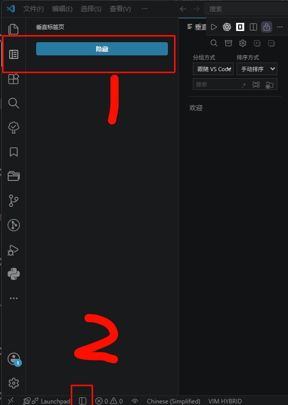

# Vertical Tabs Inside Editor Area

[English](README.md) · [简体中文（规范源）](README.zh-CN.md) · [繁體中文](docs/README.zh-TW.md) · [日本語](docs/README.ja.md) · [한국어](docs/README.ko.md) · [Español](docs/README.es.md) · [Français](docs/README.fr.md) · [Deutsch](docs/README.de.md) · [Русский](docs/README.ru.md)

Display an always-visible <mark>vertical tab bar</mark> on the <mark>left side of the editor area</mark>, without using the primary or secondary sidebar.

```text
Primary sidebar | Vertical tab bar | Editor area | Secondary sidebar
```

## Demo


## Quick Start

- Install the extension from the VS Code Marketplace:
  - https://marketplace.visualstudio.com/items?itemName=laikang287.vertical-tabs-inside-editor-area
- Restart VS Code.
- Click either button shown below to show or hide the vertical tabs:
  - 

## Extension Highlights

- Vertical tabs make it easier to work with many open files.
- The tab bar stays visible on the <mark>left side of the editor area</mark> without using either sidebar.

## Features

- **Display vertical tabs on the left side of the editor area**
- Multiple languages (i18n)
- Group tabs by native VS Code groups, manual groups, file type, or parent directory
- Sort tabs manually, by name, or by time
- Show or hide vertical tabs
- Basic tab operations:
  - Drag tabs into groups
  - Close tabs in batches
  - Expand all
  - Collapse all
  - Right-click to pin tabs or groups
  - Move tabs in batches (hold Shift to select multiple tabs)
- When grouping by parent directory, dragging a file to another group moves the actual file.
- Configure the tab bar on the left or right, and place the search, settings, and other buttons at the top or bottom.

## Switching the Interface Language

Set `verticalTabs.language` to change the extension language. The default is `auto`.

## Notes

1. Developed with LLM assistance.
2. README.zh-CN.md is maintained manually; the other READMEs are translated by an LLM.

## License

MIT License - see [LICENSE](LICENSE)

## Known Issues

- After installing or updating another extension, tabs in the vertical tab bar may sometimes stop responding to clicks. Restart VS Code to resolve this.
  - Example 1: Updating this extension can also sometimes trigger the issue.
  - Example 2: Installing or updating the VIM extension (VSCodeVim project) can trigger the issue.
