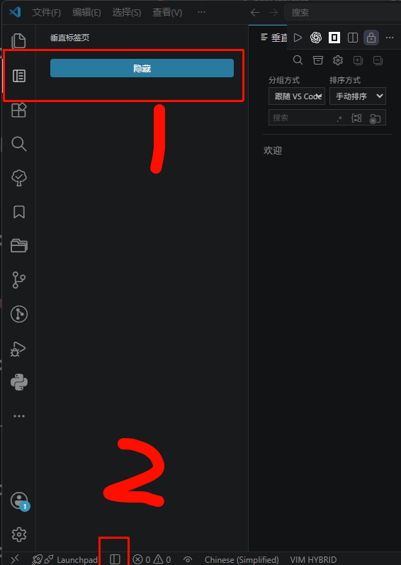

# 编辑器区域垂直标签页

[English](README.md) · [简体中文](README.zh-CN.md) · [繁體中文](docs/README.zh-TW.md) · [日本語](docs/README.ja.md) · [한국어](docs/README.ko.md) · [Español](docs/README.es.md) · [Français](docs/README.fr.md) · [Deutsch](docs/README.de.md) · [Русский](docs/README.ru.md)

在 VS Code <mark>编辑器区域左侧</mark>显示一个始终可见的<mark>垂直标签栏</mark>，不使用主侧边栏和辅助侧边栏。

界面布局如下：

```text
主侧边栏 | 垂直标签栏 | 编辑器区域 | 辅助侧边栏
```

## demo


## 快速开始

- 使用vscode 插件市场进行安装，插件地址
	- https://marketplace.visualstudio.com/items?itemName=laikang287.vertical-tabs-inside-editor-area
- 重启vscode
- 如图，点击这两个按钮，都可显示、隐藏垂直标签页
	- 

## 插件特点

- 垂直标签页，方便打开大量文件
- 不使用两个侧边栏，而是在<mark>编辑器区域左侧</mark>显示垂直标签栏，从而做到永久可见

## 功能说明

- **在编辑器区域左侧显示垂直标签页**
- 支持多种语言(i18n)
- 支持标签页分组，包括 跟随vscode原生分组、按手工分组、按类型分组、按父目录分组
- 支持标签以手工排序、名称排序、时间排序
- 可显示、隐藏垂直标签页
- 支持标签页基础功能
	- 拖拽分组
	- 批量关闭
	- 全部展开
	- 全量收起
	- 右键便签时，可固定标签页、标签组
	- 批量移动、(使用shift键可多选标签页)
- 分组类型为父目录时，拖拽文件到其它分组时，会移动实际文件
- 可配置垂直便签页显示在左侧还是右侧，可配置搜索、配置等按钮显示在顶部还是底部

## 如何切换界面语言

配置项 verticalTabs.language 可切换插件的语言，默认值为auto

## 说明

1. 使用 LLM 辅助开发
2. README.zh-CN.md手工维护，其余README由LLM翻译
## 许可证

MIT License - 详见 [LICENSE](LICENSE)

## 如何安装插件
- 方式1，vscode 插件市场安装
	- vscode 插件市场搜索 Vertical Tabs Inside Editor Area 进行安装
		- vscode 插件地址 [Vertical Tabs Inside Editor Area - Visual Studio Marketplace](https://marketplace.visualstudio.com/items?itemName=laikang287.vertical-tabs-inside-editor-area)
 - 方式2，手工安装
	- github找到 vscode-vertical-tabs-inside-editor-area 仓库 releases 目录下找到最新版的.vsix，下载
		- github 仓库地址 [vscode-vertical-tabs-inside-editor-area](https://github.com/laikang287/vscode-vertical-tabs-inside-editor-area/tree/main/releases)
	- 打开vscode——活动栏找到扩展——点击侧边栏右上角的三点查看，选择 从VISX 安装
- 注：可能需要升级vscode到较新的版本
## 已知问题

-  更新、安装其它插件时，垂直标签页有时会无法点击标签页中的标签，重启vscode即可
	- 示例1：更新本插件有时也会触发此问题
	- 示例2：安装、更新 VIM(VSCoceVim项目)插件 会触发此问题
