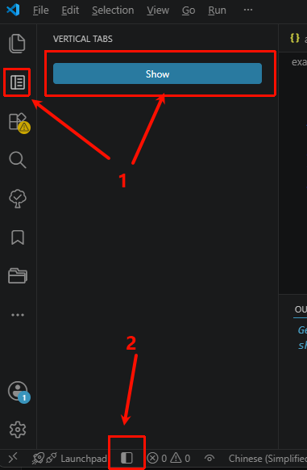

# Pestañas verticales en el área del editor

[English](README.md) · [简体中文（规范源）](README.zh-CN.md) · [繁體中文](docs/README.zh-TW.md) · [日本語](docs/README.ja.md) · [한국어](docs/README.ko.md) · [Español](docs/README.es.md) · [Français](docs/README.fr.md) · [Deutsch](docs/README.de.md) · [Русский](docs/README.ru.md)

Muestra una <mark>barra de pestañas verticales</mark> en el <mark>lado izquierdo del área del editor</mark> sin utilizar las barras laterales principal ni secundaria de VS Code, de modo que la barra pueda permanecer visible en todo momento.

```text
Barra lateral principal | Pestañas verticales | Área del editor | Barra lateral secundaria
```

## Demo


## Inicio rápido

- Instala la extensión desde el Marketplace de VS Code:
  - https://marketplace.visualstudio.com/items?itemName=laikang287.vertical-tabs-inside-editor-area
  - Nota: Para IDE derivados de VS Code, como Cursor, VSCodium, Google Antigravity y Qoder, descarga la extensión desde [Vertical Tabs Inside Editor Area – Open VSX Registry](https://open-vsx.org/extension/laikang287/vertical-tabs-inside-editor-area)
- Reinicia VS Code.
- Haz clic en cualquiera de los dos botones para mostrar u ocultar las pestañas verticales:
  - 

## Características destacadas

- Las pestañas verticales facilitan el trabajo con muchos archivos abiertos.
- La barra permanece visible a la <mark>izquierda del editor</mark> sin ocupar las barras laterales.

## Funciones

- **Mostrar pestañas verticales a la izquierda del editor**
- Compatibilidad con varios idiomas (i18n)
- Agrupar por grupos nativos de VS Code, grupos manuales, tipo de archivo o directorio padre
- Orden manual, por nombre o por tiempo
- Mostrar u ocultar las pestañas verticales
- Operaciones básicas:
  - Arrastrar a grupos
  - Cerrar en lote
  - Expandir todo
  - Contraer todo
  - Fijar pestañas o grupos con el menú contextual
  - Mover en lote (usa Shift para seleccionar varias pestañas)
- Al agrupar por directorio padre, arrastrar un archivo a otro grupo mueve el archivo real.
- Configura la barra a la izquierda o derecha y los botones de búsqueda, configuración y otros arriba o abajo.

## Cambiar el idioma de la interfaz

Cambia el idioma con `verticalTabs.language`. El valor predeterminado es `auto`.

## Notas

1. Desarrollado con ayuda de un LLM.
2. README.zh-CN.md se mantiene manualmente; los demás README son traducciones de un LLM.

## Licencia

MIT License - consulta [LICENSE](../LICENSE)

## Problemas conocidos

- Tras instalar o actualizar otra extensión, a veces no se puede hacer clic en las pestañas verticales. Reinicia VS Code para resolverlo.
  - Ejemplo 1: actualizar esta extensión también puede provocar el problema.
  - Ejemplo 2: instalar o actualizar la extensión VIM (proyecto VSCodeVim) puede provocarlo.
