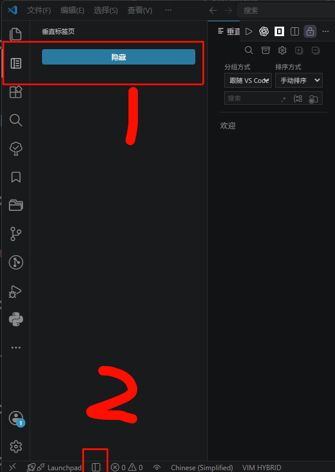

# エディター領域の垂直タブ

[English](README.md) · [简体中文（规范源）](README.zh-CN.md) · [繁體中文](docs/README.zh-TW.md) · [日本語](docs/README.ja.md) · [한국어](docs/README.ko.md) · [Español](docs/README.es.md) · [Français](docs/README.fr.md) · [Deutsch](docs/README.de.md) · [Русский](docs/README.ru.md)

VS Code の<mark>エディター領域の左側</mark>に常に表示される<mark>垂直タブバー</mark>を配置します。プライマリおよびセカンダリサイドバーは使用しません。

```text
プライマリサイドバー | 垂直タブバー | エディター領域 | セカンダリサイドバー
```

## Demo


## クイックスタート

- VS Code 拡張機能マーケットプレイスからインストールします：
  - https://marketplace.visualstudio.com/items?itemName=laikang287.vertical-tabs-inside-editor-area
- VS Code を再起動します。
- 以下のいずれかのボタンをクリックすると、垂直タブを表示・非表示にできます：
  - 

## 拡張機能の特徴

- 垂直タブで多数のファイルを扱いやすくします。
- サイドバーを使わず<mark>エディター領域の左側</mark>に表示するため、常に見えます。

## 機能

- **エディター領域の左側に垂直タブを表示**
- 多言語対応（i18n）
- VS Code 標準、手動、ファイル種類、親ディレクトリによるグループ化
- 手動、名前、時間による並べ替え
- 垂直タブの表示・非表示
- 基本操作：
  - ドラッグしてグループ化
  - 一括で閉じる
  - すべて展開
  - すべて折りたたむ
  - 右クリックでタブやグループを固定
  - 一括移動（Shift キーで複数選択）
- 親ディレクトリでグループ化している場合、別のグループにドラッグすると実際のファイルが移動します。
- タブバーの左右位置と、検索・設定などのボタンの上下位置を設定できます。

## 表示言語の切り替え

`verticalTabs.language` で言語を変更できます。既定値は `auto` です。

## 備考

1. LLM の支援を受けて開発しました。
2. README.zh-CN.md は手動で管理し、その他の README は LLM が翻訳しています。

## ライセンス

MIT License - 詳細は [LICENSE](../LICENSE) を参照してください。

## 既知の問題

- 他の拡張機能のインストールや更新後、垂直タブをクリックできなくなることがあります。VS Code を再起動してください。
  - 例 1：この拡張機能の更新でも発生することがあります。
  - 例 2：VIM 拡張機能（VSCodeVim プロジェクト）のインストールや更新で発生することがあります。
