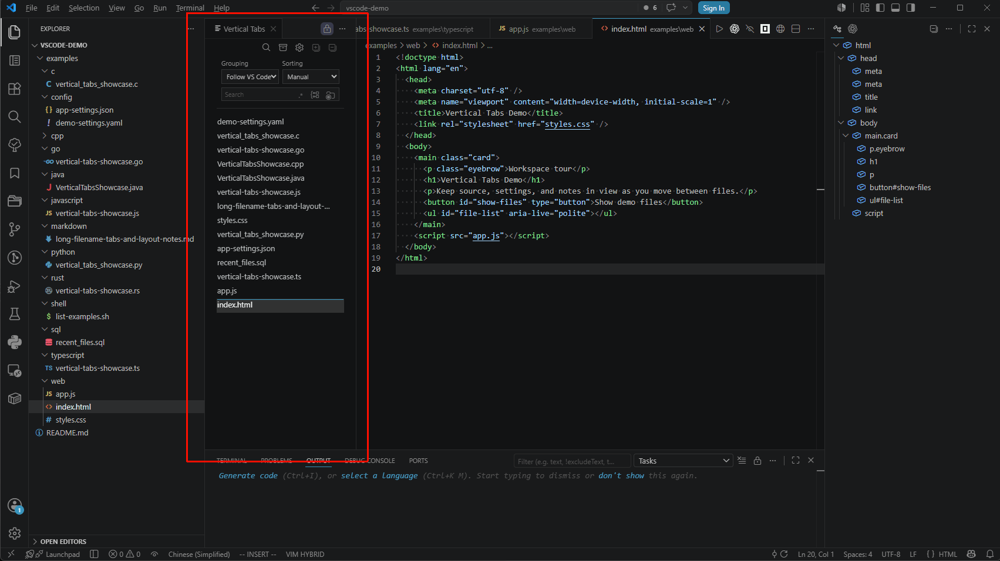

# Вертикальные вкладки в области редактора

[English](README.md) · [简体中文（规范源）](README.zh-CN.md) · [繁體中文](docs/README.zh-TW.md) · [日本語](docs/README.ja.md) · [한국어](docs/README.ko.md) · [Español](docs/README.es.md) · [Français](docs/README.fr.md) · [Deutsch](docs/README.de.md) · [Русский](docs/README.ru.md)

Отображает <mark>вертикальную панель вкладок</mark> в <mark>левой части области редактора</mark>, не задействуя основную или дополнительную боковую панель VS Code. Благодаря этому панель вкладок может оставаться видимой всё время.

```text
Основная боковая панель | Вертикальные вкладки | Область редактора | Дополнительная боковая панель
```

## Demo



## Быстрый старт

- Установите расширение из Marketplace VS Code:
  - https://marketplace.visualstudio.com/items?itemName=laikang287.vertical-tabs-inside-editor-area
  - Примечание: для IDE на основе VS Code, таких как Cursor, VSCodium, Google Antigravity и Qoder, расширение можно скачать здесь: [Vertical Tabs Inside Editor Area – Open VSX Registry](https://open-vsx.org/extension/laikang287/vertical-tabs-inside-editor-area)
- Перезапустите VS Code.
- Нажмите любую из двух показанных кнопок, чтобы показать или скрыть вертикальные вкладки:
  - 

## Особенности

- Вертикальные вкладки упрощают работу с большим числом открытых файлов.
- Панель остаётся видимой <mark>слева от редактора</mark> и не занимает боковые панели.

## Возможности

- **Вертикальные вкладки слева от области редактора**
- Поддержка нескольких языков (i18n)
- Группировка по встроенным группам VS Code, вручную, по типу файла или родительскому каталогу
- Ручная сортировка, сортировка по имени или времени
- Показ и скрытие вертикальных вкладок
- Основные операции:
  - Перетаскивание в группы
  - Массовое закрытие
  - Развернуть все
  - Свернуть все
  - Закрепление вкладок и групп через контекстное меню
  - Массовое перемещение (Shift для множественного выбора)
- При группировке по родительскому каталогу перетаскивание в другую группу перемещает сам файл.
- Можно расположить панель слева или справа, а кнопки поиска, настроек и другие — сверху или снизу.

## Смена языка интерфейса

Измените `verticalTabs.language`, чтобы выбрать язык. Значение по умолчанию — `auto`.

## Примечания

1. Разработано с помощью LLM.
2. README.zh-CN.md поддерживается вручную, остальные README переведены с помощью LLM.

## Лицензия

MIT License — см. [LICENSE](../LICENSE)

## Известные проблемы

- После установки или обновления другого расширения вертикальные вкладки иногда перестают реагировать на нажатия. Перезапустите VS Code.
  - Пример 1: обновление этого расширения также иногда вызывает проблему.
  - Пример 2: установка или обновление расширения VIM (проект VSCodeVim) может вызвать проблему.
